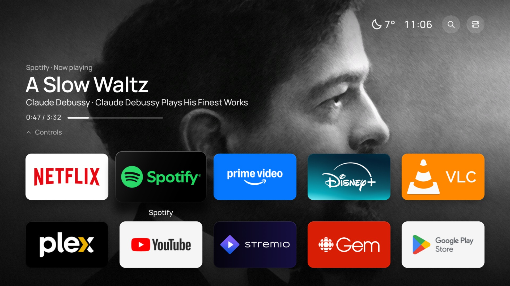
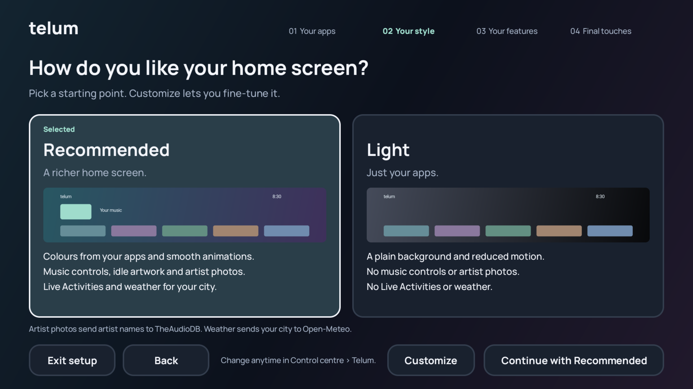
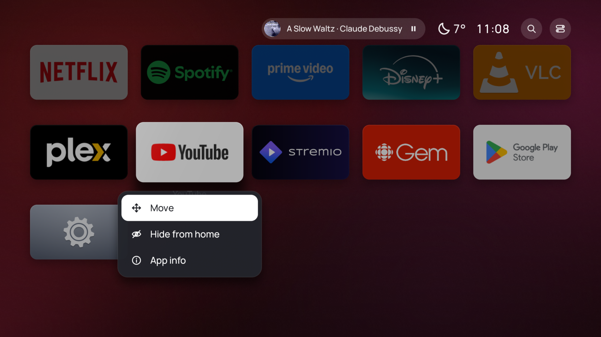
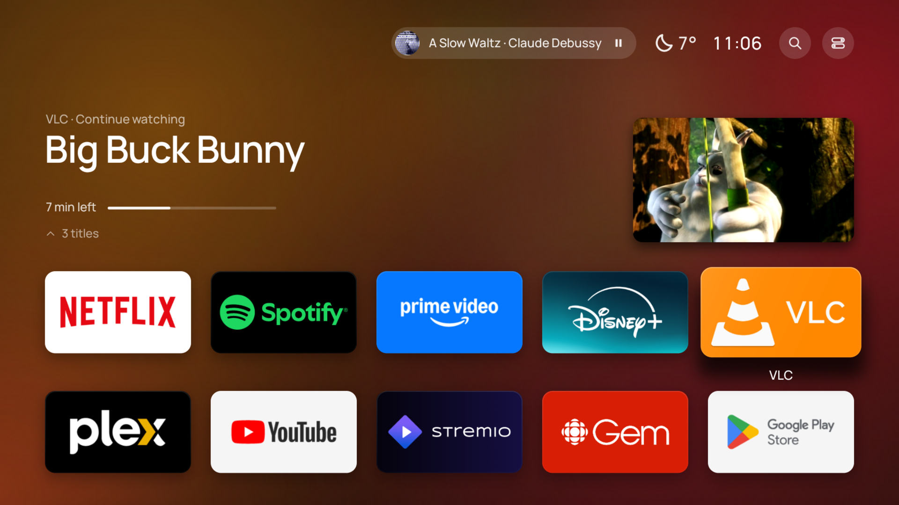

# Telum

Telum is a home screen app for Android TV. It puts your apps first, adds no advertisements, and lets you select what the home screen shows.



Developed by Shantanu Singh with Claude and OpenAI Codex.

Telum is optimized for NVIDIA SHIELD TV. Other Android TV devices with Android 10 or newer can also use it. Compatibility with all devices is not confirmed.

**[Download the latest APK](https://github.com/singhuu/Telum/releases/latest/download/telum.apk)** · [All releases](https://github.com/singhuu/Telum/releases) · [Install with an AI agent](#install-telum) · [Manual installation](docs/INSTALL.md) · [Troubleshooting](docs/TROUBLESHOOTING.md)

Telum takes its name from a historical name for the star Gamma Sagittae. See the [star-name entry](https://ase.exopla.net/index.php/Telum).

## What Telum does

| Feature | Telum behavior |
| --- | --- |
| Your apps come first | Large app tiles are easy to use with a remote. Hold OK on a tile to move it or hide it. |
| No added advertisements | Telum adds no sponsored rows, no analytics, and no account. Streaming apps control their own advertisements. |
| Guided setup | At the first start, you select your apps, put them in order, and select a style. You can do the setup again at any time. |
| Content is optional | You select if Home shows app content, music controls, weather, and artist photos. |
| Backgrounds follow your apps | Known services have their own colors. Other apps use colors from their artwork. |
| A dim music display | When music plays and you do not touch the remote for 60 seconds, dim album art or an artist photo replaces the tiles. |
| Animations stop when settled | Telum stops drawing when the screen does not change. See [test results and limits](docs/PERFORMANCE.md). |

The dim music display moves the artwork each minute. It does not change the screensaver settings of the TV device. Push an arrow, OK, or Back to show the home screen again. The dim music display decreases static content, but it does not prevent screen burn-in.

<table>
  <tr>
    <td width="50%"><br>Guided setup: select Recommended or Light, or select Customize.</td>
    <td width="50%"><br>Hold OK on a tile to move it or hide it.</td>
  </tr>
  <tr>
    <td width="50%"><br>Select an app in the first row to see its content. Here, VLC shows Continue watching.</td>
    <td width="50%"><br>The dim music display shows when music plays for 60 seconds without the remote.</td>
  </tr>
</table>

Picture credits: the photo of Claude Debussy is by Atelier Nadar, about 1908, and is in the public domain. *Big Buck Bunny* is © Blender Foundation, [CC BY 3.0](https://creativecommons.org/licenses/by/3.0/). App names and logos belong to their owners.

## Install Telum

The recommended procedure uses an AI agent. The agent does the steps with you, examines each result, and helps you correct problems.

### What you must have

- An Android TV device with Android 10 or newer. The primary target is NVIDIA SHIELD TV with SHIELD Experience 9 (Android 11).
- A Windows, macOS, or Linux computer on the same home network as the TV device.
- The remote of the TV device.
- An AI agent. Use the table below to select one.

### Select an AI agent

| Type | Examples | How it helps you |
| --- | --- | --- |
| AI agent on your computer (recommended) | Claude Code, OpenAI Codex CLI, Gemini CLI, GitHub Copilot agent mode in Visual Studio Code | The agent runs the commands on your computer and reads the results. It finds and corrects problems. You approve each command. |
| AI chat | ChatGPT, Claude, or Gemini in a web browser or a phone app | The chat gives you one command at a time. You type each command on your computer and send the result back. |

An agent that operates in a cloud service cannot connect to devices on your home network. Use an agent that operates on your computer.

### Start the installation

1. Open the AI agent on your computer.
2. Copy this request into the agent:

```text
Help me install the Telum home screen on my Android TV device.
First, read the agent guide: https://raw.githubusercontent.com/singhuu/Telum/main/docs/INSTALL-AGENT.md
Follow that guide and the documents that it links. Download Telum only from https://github.com/singhuu/Telum/releases.
Do one step at a time. Examine each result before the next step, and help me correct problems.
Ask me before you install software, change my Home app, or disable an app.
```

3. Answer the questions from the agent.
4. When the agent tells you, do the steps on the TV with the remote.

If the agent cannot open web links, tell it to stop. Then copy the text of the [agent guide](docs/INSTALL-AGENT.md) into the agent.

### What the agent does

1. It identifies your TV device and its Android version.
2. It installs Android Debug Bridge (ADB) on your computer, if necessary. ADB is a tool from Google that sends commands to the TV device through your network.
3. It downloads `telum.apk` from the [Releases page](https://github.com/singhuu/Telum/releases) and examines its checksum.
4. It connects to the TV device. You approve the connection on the TV screen.
5. It records how to restore your current home screen.
6. It installs Telum and opens it. You do the setup screens with the remote.
7. It makes Telum your Home app, if you agree. On SHIELD TV, this step disables the original Android TV Home app. You can enable it again at any time.
8. It gives you a report and the commands that restore your previous home screen.

### Install without an AI agent

Use the [manual installation guide](docs/INSTALL.md). It has the same steps and all the commands. For errors, use the [troubleshooting guide](docs/TROUBLESHOOTING.md).

To try Telum as an app without a computer, see [Install from the TV](docs/INSTALL.md#install-from-the-tv-without-a-computer). That procedure cannot make Telum the Home app on SHIELD TV.

## Download

Each [release](https://github.com/singhuu/Telum/releases) contains these files:

| File | Use |
| --- | --- |
| `telum.apk` | The signed installation file. |
| `SHA256SUMS` | The SHA-256 checksum of `telum.apk`. Use it to make sure that the download is complete and correct. |

The release notes give the version, the source commit, the signing certificate fingerprint, and the device tests. GitHub Actions builds each APK from the tagged source.

Do not install a Telum APK from a different website. The **Source code** files on a release page are source archives. They cannot install the app.

## Device and app support

| Device | Status |
| --- | --- |
| NVIDIA SHIELD TV and SHIELD TV Pro, SHIELD Experience 9 (Android 11) | Primary target. Telum becomes the Home app after you disable the original Android TV Home app with ADB. The guides show how. |
| Other Android TV and Google TV devices, Android 10 or newer | Telum can operate as an app. The Home change depends on the device software. The guides tell you what to do if the device does not let Telum become the Home app. |
| Android 9 or older | Not supported. |

Telum shows each installed app that has a TV launch activity. The tile and background colors of Netflix do not need a subscription. App content and recommendations depend on the app, your account, your region, and the device software. Telum cannot show content that an app does not share. See [app support](docs/APPS.md).

## Update or remove Telum

To update Telum, install the new `telum.apk` over the installed app. Your Telum settings stay. See [Update Telum](docs/INSTALL.md#update-telum).

To remove Telum, first restore your previous Home app. Then uninstall Telum. See [Remove Telum](docs/INSTALL.md#remove-telum).

## Privacy

Telum has no account, analytics, or telemetry. Weather and artist photos are off until you turn them on. Their providers get requests only when you turn on the related feature. See [privacy](docs/PRIVACY.md) and [third-party notices](THIRD_PARTY_NOTICES.md).

## Build from source

To build a test APK on your computer, use the [build procedure](docs/INSTALL.md#build-a-test-apk). Maintainers publish releases with the [release procedure](docs/RELEASING.md).

The package name is `dev.telum.launcher`. For changes to the source, read [contributing](CONTRIBUTING.md).

## Project status

This is an early release. Each release gives its device tests in the release notes. The repository has build checks, behavior checks, and a [device test checklist](docs/TESTING.md). A test on one device does not prove that Telum operates correctly on all devices or with all streaming accounts.

To report a problem, use [Issues](https://github.com/singhuu/Telum/issues). Do not put IP addresses, serial numbers, pairing codes, or account data in an issue.

## License

The original source of Telum uses [GPL-3.0-only](LICENSE). The bundled fonts, icons, and the Gradle wrapper keep their own licenses. See [third-party notices](THIRD_PARTY_NOTICES.md).

Telum is an independent project. NVIDIA, Google, and the named streaming services do not endorse it.
